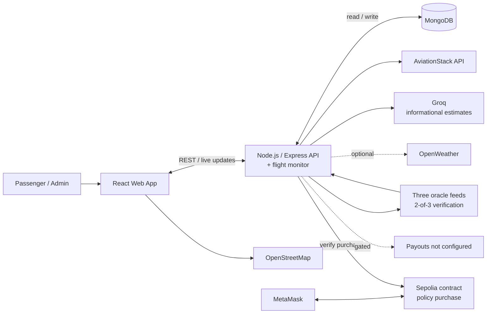

# FlightSure

FlightSure is a React passenger/admin interface backed by an Express and MongoDB service. Account-specific screens request authenticated API data; the app does not ship sample flights, users, predictions, policies, verification reports, wallet balances, or payouts.

## Local development

Requirements: Node.js 20+, npm, and a local MongoDB instance (MongoDB 7+ recommended). The API defaults to `mongodb://127.0.0.1:27017/flightsure`.

1. Make sure your local MongoDB Windows service is running. If MongoDB is installed as a Windows service, check it with:

   ```powershell
   Get-Service MongoDB
   ```

   Alternatively, if using Docker Desktop:

   ```bash
   docker compose up -d mongodb
   ```

2. Configure and start the API:

   ```powershell
   Copy-Item flightsure-backend\.env.example flightsure-backend\.env
   ```

   Set a private `JWT_ACCESS_SECRET` of at least 32 characters in `flightsure-backend\.env`. Provider, Groq, weather, oracle, payment, and blockchain integrations are optional and remain unavailable until configured.

   To fetch and store real flight information, create an AviationStack API key and set `FLIGHT_PROVIDER_API_KEY` in `flightsure-backend\.env`. The endpoint is preconfigured as `https://api.aviationstack.com/v1/flights`. Restart the API after changing the file. Successful searches in **Find flights** are upserted into MongoDB's `flights` collection; provider observations are stored in `flightsourcerecords`. No sample flight records are seeded.

   For current conditions at the airports of a selected flight, set `OPENWEATHER_API_KEY` in `flightsure-backend\.env`. The authenticated `/api/flights/:flightId/weather` endpoint uses the bundled airport coordinates and server-side OpenWeather calls. The prediction screen shows source timestamps and marks observations older than 45 minutes as stale. These are current airport observations, not scheduled-flight forecasts, and are not used to determine compensation. Without a key, weather stays unavailable rather than showing fabricated data.

   To enable informational flight-delay estimates, create an API key in the [Groq Console](https://console.groq.com/keys) and set `GROQ_API_KEY` in `flightsure-backend\.env`. `GROQ_MODEL` defaults to `openai/gpt-oss-120b`. The key stays server-side. Groq receives only stored flight-provider fields and generates an uncalibrated heuristic estimate; it is not a trained or validated forecasting model, and it never affects policy pricing, eligibility, or payouts. Restart the backend after configuring the key.

   ```bash
   npm --prefix flightsure-backend install
   npm --prefix flightsure-backend start
   ```

   API liveness: [http://localhost:4000/api/health/live](http://localhost:4000/api/health/live). Readiness additionally requires a MongoDB connection.

3. Start the frontend in another terminal:

   ```bash
   Copy-Item .env.example .env
   npm install
   npm start
   ```

   The frontend uses `http://localhost:4000/api` by default. Flight routes use OpenStreetMap tiles and airport coordinates bundled from the public-domain [OurAirports data](https://github.com/davidmegginson/ourairports-data); no maps API key, billing, or geocoding service is required. OpenStreetMap attribution is shown on the map. Route maps show airport-to-airport routes only, not live aircraft positions.

4. Optional Sepolia policy purchases (testnet only):

   Install the contract dependencies and create a private deployment environment file:

   ```powershell
   npm --prefix contracts install
   Copy-Item contracts\.env.example contracts\.env
   ```

   Set `SEPOLIA_RPC_URL`, `DEPLOYER_PRIVATE_KEY`, and `ORACLE_PRIVATE_KEY` locally in `contracts\.env`. Use a Sepolia-funded test wallet; never put a real wallet key in either environment file. Deploy and authorize the oracle signer:

   ```powershell
   npm --prefix contracts run deploy:sepolia
   ```

   Set the resulting contract address, the same Sepolia RPC, `BLOCKCHAIN_CHAIN_ID=11155111`, and the matching authorized oracle key as `BLOCKCHAIN_SIGNER_PRIVATE_KEY` in `flightsure-backend\.env`. The sample `POLICY_CATALOG_JSON` in the backend example is test-only and denominates premiums and payout tiers in wei. Review those terms before enabling them. Restart the backend after configuring it. The API checks the chain and verifies the mined purchase event and immutable on-chain terms before activating a policy.

   Contract tests run locally without a deployment: `npm --prefix contracts test`. The contract and deployment are unaudited and intended for Sepolia evaluation, not production funds.

## Tests

```bash
npm test -- --watchAll=false
npm run build
npm --prefix flightsure-backend test
```

## Integration status and trust boundaries

- Flight search requires a configured AviationStack-compatible endpoint and API key. Provider credentials remain server-side; searches fail explicitly if the provider is not configured.
- AviationStack account plans may restrict search filters such as flight date. The API reports a specific date-filter restriction instead of treating it as a network or credential failure; enable scheduled/historical date search with the provider or use a plan that supports it.
- A provider search upserts real flight schedules in MongoDB. The authenticated `/api/flights/recent` endpoint exposes recently updated public flight records so passengers can request a prediction before buying coverage.
- Optional Groq estimates use stored AviationStack flight fields only. They are uncalibrated AI-generated heuristics, not trained delay forecasts; they cannot authorize compensation. Current airport weather is not included in the estimate.
- Oracle verification requires three separately configured feeds and fresh, agreeing reports. Provider identities must be independently operated; distinct configuration values alone cannot prove upstream independence. Disagreement or unavailable feeds remain pending.
- Policy catalog entries can be configured through `POLICY_CATALOG_JSON`. The wallet purchase path and confirmation checks are implemented for the Sepolia test contract; policy activation stays unavailable until a Sepolia RPC and deployed contract are configured. Current catalog terms are test-only ETH/wei values.
- Compensation is calculated from verified arrival evidence and the stored policy terms. Payout execution, contract submission, and transaction success remain unavailable until a contract and signer adapter are implemented and confirmation can be observed.
- Wallet linking verifies an explicit signature. The API never receives a seed phrase or private key. Do not configure production secrets in the frontend or commit environment files.

## Architecture flow and release gates

1. A passenger registers, then can link an EVM wallet with a one-time signed message from **Wallet**. Email/password accounts remain accessible if a wallet is not available; policy purchase also requires a configured Sepolia deployment.
2. The passenger searches a route and date. Provider results are normalized and stored in MongoDB only after a successful provider response.
3. A fetched flight can be sent to **AI predictions**. When `GROQ_API_KEY` is configured, Groq returns an uncalibrated heuristic estimate from stored provider fields. It is not a trained or verified forecast and never starts or authorizes a claim.
4. **My insurance** displays only backend-configured, versioned terms. With a Sepolia deployment configured, the user confirms an ETH testnet purchase in MetaMask; the API verifies the receipt and on-chain policy terms before activating it.
5. The monitor refreshes active-policy flights. Arrival evidence is collected from three independently operated, fresh sources; two agreeing sources are required. Missing or disagreeing reports remain pending.
6. Compensation is computed from the verified delay and policy terms snapshot. A payout is not shown as successful unless a configured contract transaction is confirmed.

The current local setup has MongoDB and the AviationStack-compatible provider configured. A Groq API key, three independent oracle feeds, a deployed Sepolia contract, and the user's Sepolia wallet configuration are separate integration requirements. The backend example contains test-only sample policy terms, but copying it does not deploy the contract or authorize purchases. Those are external deployment inputs, not values the app can safely fabricate. Payout submission is still gated until the oracle-to-contract settlement path is configured and confirmed. See the admin integration-readiness screen and service errors for the current gate state.

## Architecture diagram



Groq estimates are informational only. Oracle disagreement remains pending, and payouts are gated until submission and on-chain confirmation are implemented.

## API overview

All account routes require a bearer access token, except registration, login, and health. The API includes:

- `/api/auth`: register, login, logout, current account.
- `/api/users/profile`, `/api/wallet`: account preferences and signed wallet linking.
- `/api/flights`, `/api/policies`, `/api/predictions`: provider-backed search and authenticated account records.
- `/api/flights/:flightId/weather`: authenticated current airport observations from OpenWeather; requires `OPENWEATHER_API_KEY`.
- `/api/oracle`, `/api/compensation`, `/api/blockchain`: gated verification and transaction workflows.
- `/api/dashboard`, `/api/notifications`: passenger data and notification feed.
- `/api/admin`: administrator-only operational views and monitoring controls.

Admin bootstrap is optional; set `ADMIN_BOOTSTRAP_EMAIL` and `ADMIN_BOOTSTRAP_PASSWORD` in the backend environment, then run `npm --prefix flightsure-backend run seed:admin`. The script creates or promotes that account, so keep the bootstrap credentials private and unset them after use.
